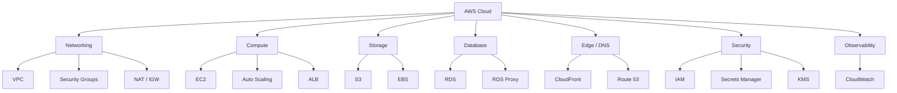
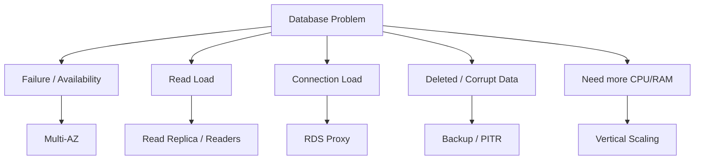
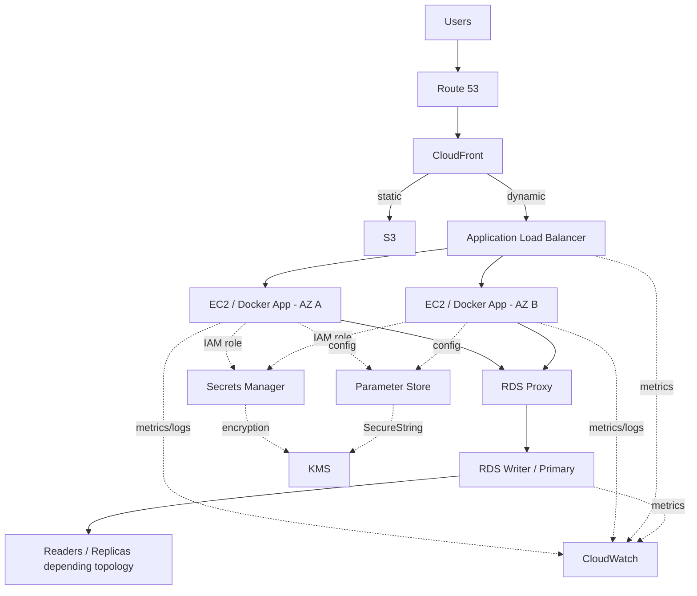

# ☁️ AWS / Cloud — Master Revision Notes

> **DevOps From First Principles — Unit 04**
>
> **Purpose:** Fast revision + deep conceptual recall + production architecture thinking  
> **Style:** Black-box first → Why → Architecture → Internals → Practical flow → Common traps → Active Recall  
> **Language:** Hinglish, with exact AWS/technical terms kept in English  
> **Visuals:** Official AWS documentation diagrams + GitHub-renderable Mermaid diagrams  
> **Status:** ✅ AWS fundamentals section complete

---

## How to use these notes

Ye notes normal textbook notes nahi hain. Inka goal hai ki revision ke time tum sirf definitions yaad na karo, balki **poora AWS system mind mein run kar sako**.

Recommended revision modes:

| Mode | Time | What to do |
|---|---:|---|
| ⚡ **Flash Revision** | 15–20 min | `WHO SOLVES WHAT?`, comparison tables, Common Traps, final Active Recall |
| 🧠 **Strong Revision** | 45–60 min | Every section ke mental model + diagrams + Active Recall |
| 🔥 **Deep Revision** | 2–3 hr | Full notes, request journeys, failure flows, IAM/network debugging, RDS architecture |
| 🛠️ **Hands-on Prep** | Variable | Commands, route tables, security groups, IAM examples, deployment mental models |

> **Golden revision rule:** Har AWS service ke liye pehle ye bolo:  
> **“Ye service kis problem ko solve karti hai?”**  
> Uske baad hi configuration details yaad karo.

---

# Table of Contents

1. [AWS ka Big Picture](#1--aws-ka-big-picture)
2. [Regions, Availability Zones & Global Infrastructure](#2--regions-availability-zones--global-infrastructure)
3. [VPC & Networking](#3--vpc--networking)
4. [EC2 Properly](#4--ec2-properly)
5. [Docker on EC2](#5--docker-on-ec2)
6. [ALB + Auto Scaling + Multi-AZ](#6--alb--auto-scaling--multi-az)
7. [Amazon S3](#7--amazon-s3)
8. [Amazon RDS Fundamentals](#8--amazon-rds-fundamentals)
9. [RDS Backups, PITR & Snapshots](#9--rds-backups-pitr--snapshots)
10. [RDS Proxy](#10--rds-proxy)
11. [Read Replicas & Advanced RDS Architecture](#11--read-replicas--advanced-rds-architecture)
12. [CloudFront + CDN](#12--cloudfront--cdn)
13. [Route 53](#13--route-53)
14. [CloudWatch + Monitoring](#14--cloudwatch--monitoring)
15. [IAM Deep Dive](#15--iam-deep-dive)
16. [Secrets Manager + Parameter Store + KMS](#16--secrets-manager--parameter-store--kms)
17. [Final Production Architecture](#17--final-production-architecture)
18. [Failure & Debugging Playbook](#18--failure--debugging-playbook)
19. [Master Comparison Tables](#19--master-comparison-tables)
20. [Final Active Recall Bank](#20--final-active-recall-bank)
21. [Official AWS Visual / Documentation Index](#21--official-aws-visual--documentation-index)

---

# 1. ☁️ AWS ka Big Picture

## 1.1 Cloud actually hai kya?

Cloud ka matlab “internet mein computer” nahi hai.

Behind AWS:

```text
Physical data centers
        ↓
Racks
        ↓
Physical servers
        ↓
CPU / RAM / disks / networking
        ↓
Virtualization
        ↓
Automation + APIs
        ↓
AWS services
```

AWS ne physical infrastructure ko **programmable infrastructure** bana diya.

Tum console mein click karte ho:

```text
Launch EC2
Create VPC
Create RDS
Create ALB
```

Behind the scenes ultimately AWS APIs/resources configure hote hain.

### Mental model

> **AWS Console = GUI over AWS control-plane APIs.**

Isi reason se later Terraform possible hai:

```text
Terraform
   ↓
AWS APIs
   ↓
same resources
```

So AWS seekhna sirf console seekhna nahi hai. Tum actually **cloud primitives** samajh rahe ho.

---

## 1.2 Traditional server vs cloud

### Traditional

```text
Need server
  ↓
Buy hardware
  ↓
Rack it
  ↓
Networking
  ↓
Install OS
  ↓
Maintain hardware
```

### Cloud

```text
Need compute
  ↓
API / Console
  ↓
EC2 created
```

But underlying physical hardware still exists.

> Cloud **removes hardware ownership from you**; hardware itself disappear nahi hota.

---

## 1.3 AWS service categories — quick mental map



---

## Active Recall — AWS Big Picture

**Q. Cloud ka physical hardware hota hai?**  
→ Yes. Cloud physical infrastructure ko virtualization, automation aur APIs ke through expose karta hai.

**Q. AWS Console aur AWS API relation?**  
→ Console essentially AWS APIs/resources ko graphical interface se control karta hai.

**Q. Terraform later AWS ke saath kaise fit karega?**  
→ Terraform AWS APIs ko declaratively call karke infrastructure create/manage karega.

---

# 2. 🌍 Regions, Availability Zones & Global Infrastructure

## 2.1 Region

**AWS Region** = geographic area jahan AWS multiple isolated infrastructure locations operate karta hai.

Example mental model:

```text
AWS
 ↓
Region
 ↓
Mumbai
```

Tum generally choose karte ho ki workload kis Region mein create hoga.

Region choice depends on things like:

- latency
- service availability
- compliance/data residency
- pricing
- disaster-recovery design

---

## 2.2 Availability Zone (AZ)

Region ke andar multiple **Availability Zones** hote hain.

```text
Region
│
├── AZ-A
├── AZ-B
└── AZ-C
```

AZ ka main value:

> Ek failure domain fail ho, toh doosre AZ mein workload continue kar sake.

### Wrong architecture

```text
AZ-A
├── App 1
├── App 2
└── DB

AZ-A down
   ↓
Everything down
```

### Better

```text
AZ-A             AZ-B
 App              App
  │                │
  └──── ALB ───────┘

DB Primary       DB standby/reader
```

---

## 2.3 Region vs AZ vs Edge Location

| Concept | Purpose |
|---|---|
| **Region** | Major geographic AWS deployment area |
| **Availability Zone** | Regional failure isolation |
| **Edge Location / POP** | CloudFront content delivery near users |

Never confuse:

```text
AZ
≠
CloudFront Edge Location
```

Edge location tumhari EC2 AZ nahi hai.

---

## Memory Line

> **Region = broad geography**  
> **AZ = failure isolation inside Region**  
> **Edge = delivery point close to user**

---

# 3. 🌐 VPC & Networking

## 3.1 Black-box first

**VPC — Virtual Private Cloud**

> AWS ke andar tumhara logically isolated network.

```text
AWS Region
   ↓
VPC
   ↓
your IP ranges
subnets
routes
security
resources
```

Example:

```text
VPC CIDR:
10.0.0.0/16
```

Ye tumhare VPC ka private address range define karta hai.

---

## 3.2 Official AWS VPC visual


> Official source: [AWS VPC — private subnets + NAT example](https://docs.aws.amazon.com/vpc/latest/userguide/vpc-example-private-subnets-nat.html)

Image mein observe karo:

- 2 Availability Zones
- public subnets
- private subnets
- Application Load Balancer
- NAT gateways
- Auto Scaling servers
- S3 gateway endpoint

Ye almost wahi structure hai jo humne apne production architecture mein build kiya.

---

## 3.3 CIDR quickly

Example:

```text
10.0.0.0/16
```

High-level meaning:

```text
Network range
10.0.x.x
```

Exact binary CIDR calculation networking unit ka topic hai, but AWS mental model:

> CIDR decides **kaunse IP addresses tumhare network/subnet ke andar ho sakte hain**.

Example subnet ranges:

```text
VPC: 10.0.0.0/16

Public subnet A:
10.0.1.0/24

Public subnet B:
10.0.2.0/24

Private app A:
10.0.11.0/24

Private app B:
10.0.12.0/24
```

---

## 3.4 Subnet

Subnet = VPC ka smaller network section.

```text
VPC
├── Public Subnet
├── Public Subnet
├── Private Subnet
└── Private Subnet
```

### Critical rule

> **Subnet public/private naam se nahi, routing se banta hai.**

Public subnet ka typical property:

```text
0.0.0.0/0
   ↓
Internet Gateway
```

Private subnet:

```text
No direct default route
to Internet Gateway
```

---

# 3.5 Route Table

Route table asks:

> **Destination ke liye packet kahan bhejna hai?**

Example:

| Destination | Target |
|---|---|
| `10.0.0.0/16` | `local` |
| `0.0.0.0/0` | `igw-...` |

Meaning:

```text
VPC internal traffic
10.0.0.0/16
   ↓
local


everything else
0.0.0.0/0
   ↓
Internet Gateway
```

---

## 3.6 Important doubt — `10.0.0.0/16` aur `0.0.0.0/0` dono match karte hain?

Suppose destination:

```text
10.0.2.10
```

Technically:

```text
10.0.0.0/16
```

also matches.

And:

```text
0.0.0.0/0
```

also matches because `/0` means all IPv4 addresses.

So kaunsa route?

# Longest Prefix Match

AWS chooses **most-specific matching route**.

```text
10.0.0.0/16
    ↓
more specific

0.0.0.0/0
    ↓
least specific
```

Therefore internal VPC destination:

```text
10.0.2.10
```

uses:

```text
10.0.0.0/16 → local
```

not Internet Gateway.

### Memory line

> **Multiple routes match? Most specific route wins.**

---

## 3.7 `local` route

Every VPC route table has a local route for VPC communication.

```text
EC2 A
10.0.1.10
   ↓
local route
   ↓
EC2 B
10.0.2.20
```

It means:

> Destination same VPC CIDR mein hai → traffic VPC ke internal networking mein route karo.

Important distinction:

```text
Route Table
→ WHERE traffic goes

Security controls
→ WHETHER traffic is permitted
```

A route existing does not automatically mean SG/NACL allow the packet.

---

# 3.8 Internet Gateway — IGW

**Internet Gateway** attaches to VPC and allows internet connectivity for appropriately routed resources.

```text
Internet
   ↕
Internet Gateway
   ↕
VPC
```

For an EC2 to be directly IPv4 internet-reachable, several things line up karne chahiye:

```text
Public subnet route
        +
public IPv4 / Elastic IP
        +
Security Group allows traffic
        +
service actually listening
```

Just IGW attach kar dene se EC2 automatically public nahi ho jata.

---

# 3.9 NAT Gateway

Problem:

App EC2 ko private rakhna hai:

```text
Internet
   X
Private EC2
```

But EC2 ko outbound chahiye:

```text
npm registry
OS updates
third-party APIs
```

Use NAT.

```text
Private EC2
   ↓
Private subnet route
   ↓
NAT Gateway
   ↓
Internet Gateway
   ↓
Internet
```

### Core rule

> **NAT Gateway lets private workloads initiate outbound IPv4 connections; it does not make them directly inbound-public.**

### Classic route tables

Public subnet:

```text
10.0.0.0/16 → local
0.0.0.0/0   → IGW
```

Private subnet:

```text
10.0.0.0/16 → local
0.0.0.0/0   → NAT Gateway
```

### Availability nuance

Historically/common design uses **zonal NAT gateways**, often one per AZ for resilience and avoiding cross-AZ dependency.

AWS also now offers **regional NAT gateways** in supported scenarios, which can automatically expand across AZs. Keep the mental model simple:

> NAT provides controlled outbound path; exact HA topology depends on NAT type/design.

---

# 3.10 Security Group vs NACL

## Security Group

Attached to resource/network interface.

Characteristics:

- **stateful**
- allow rules
- return traffic automatically recognized
- common primary firewall around EC2/ALB/RDS

Example:

```text
App SG inbound:
3000 from ALB-SG
```

Meaning:

> App ko random internet se port 3000 access nahi; only traffic from ALB security group.

---

## Network ACL (NACL)

Attached to subnet boundary.

Characteristics:

- **stateless**
- allow + deny
- inbound and outbound separately considered
- subnet-level control

### Easy distinction

| Security Group | NACL |
|---|---|
| Resource-level | Subnet-level |
| Stateful | Stateless |
| Allow-centric | Allow + Deny |
| Most common day-to-day app control | Coarser subnet control |

---

# 3.11 Route Table vs SG vs NACL

This distinction DevOps debugging mein gold hai.

```text
Route Table:
"Packet kahan jayega?"


Security Group:
"Resource ko ye network traffic allow hai?"


NACL:
"Subnet boundary par traffic allowed hai?"
```

---

# 3.12 Public/private IP + Elastic IP

An EC2 can have:

```text
Private IPv4
```

for VPC communication.

It may also have public IPv4 mapping.

Important:

> Linux inside EC2 often primarily sees its private interface/IP; public IPv4 mapping is handled by AWS networking.

### Public IP lifecycle

Normal public IPv4 can change across certain lifecycle events/configurations.

### Elastic IP (EIP)

Elastic IP = AWS-account allocated persistent public IPv4 resource that you can associate/reassociate.

Mental model:

```text
normal public IP
→ AWS assigned mapping


Elastic IP
→ explicitly allocated public IPv4 resource
```

Don't use EIP everywhere just because “fixed IP sounds nice”. Managed DNS/load balancers are often the better abstraction.

---

## VPC Active Recall

**Q. VPC kya hai?**  
→ AWS Region ke andar logically isolated virtual network.

**Q. Public subnet kya define karta hai?**  
→ Typically route table mein Internet Gateway tak route; sirf name “public” enough nahi.

**Q. `10.0.0.0/16 → local`?**  
→ Same VPC CIDR ke traffic ko internally route karta hai.

**Q. `0.0.0.0/0`?**  
→ All IPv4 destinations ka default catch-all.

**Q. Agar both routes match karein?**  
→ Most-specific/longest-prefix route wins.

**Q. NAT ka main purpose?**  
→ Private resources ko outbound IPv4 connectivity dena without unsolicited inbound internet access.

**Q. Route Table vs SG?**  
→ Route table decides path; SG decides permission.

**Q. SG stateful?**  
→ Yes.

**Q. NACL stateful?**  
→ No, stateless.

---

# 4. 🖥️ EC2 Properly

## 4.1 Black-box first

**Amazon EC2 — Elastic Compute Cloud**

> AWS ka managed virtual-machine service.

Mental model:

```text
AWS physical server
      ↓
virtualization
      ↓
EC2 virtual machine
      ↓
Linux / Windows
      ↓
your software
```

Tum choose karte ho:

```text
AMI
Instance type
Network
Storage
Security Group
IAM role
Key pair
User Data
```

---

# 4.2 EC2 placement stack

```text
AWS Region
   ↓
Availability Zone
   ↓
VPC
   ↓
Subnet
   ↓
ENI
   ↓
EC2
   ↓
Linux
   ↓
Application
```

---

# 4.3 AMI — Amazon Machine Image

AMI is a **launch template/image for an EC2 operating-system environment**.

Contains/defines things such as:

- OS image
- root volume snapshot mappings
- launch permissions
- block-device mappings

Think:

> **AMI = machine template**  
> **EC2 instance = running machine created from that template**

---

## Official AWS AMI workflow


> Official source: [Create an Amazon EBS-backed AMI](https://docs.aws.amazon.com/AWSEC2/latest/UserGuide/creating-an-ami-ebs.html)

Visual flow:

```text
AMI #1
 ↓
launch EC2
 ↓
customize EC2
 ↓
create new AMI
 ↓
launch more EC2s
```

### AMI vs Docker Image

| AMI | Docker Image |
|---|---|
| VM/machine template | Container filesystem/app template |
| Includes OS-level machine environment | Usually app + runtime/dependencies |
| Launches EC2 | Launches container |
| Infrastructure layer | Application packaging layer |

```text
AMI
 ↓
EC2
 ↓
Ubuntu
 ↓
Docker
 ↓
Docker Image
 ↓
Container
```

---

# 4.4 Instance Type

Instance type describes hardware capacity.

Conceptually:

```text
t3.medium
m7i.large
c7g.large
...
```

Different families optimize different workloads:

- general purpose
- compute optimized
- memory optimized
- storage optimized
- accelerated/GPU

### vCPU

A vCPU represents a virtual processor execution unit exposed to the VM.

Docker inside EC2 ultimately consumes EC2's compute resources.

```text
EC2 CPU/RAM
   ↓
Docker Engine
   ↓
Containers
```

Containers don't create hardware out of nowhere.

---

# 4.5 EBS — Elastic Block Store

EBS = block storage volume that can be attached to EC2.

Think:

> EC2 = computer  
> EBS = virtual disk

Typical:

```text
EC2
├── Root EBS volume
└── Additional EBS volume
```

### EBS vs Docker Volume

| EBS | Docker volume |
|---|---|
| AWS infrastructure storage | Docker storage abstraction |
| Attached to EC2 | Mounted into container |
| Exists at VM layer | Exists at container runtime layer |

Possible stack:

```text
EBS disk
 ↓
Linux filesystem
 ↓
Docker volume
 ↓
Container path
```

---

# 4.6 Stop vs Terminate

## Stop

```text
Running EC2
 ↓
Stopped
```

Instance can later start again.

Persistent EBS typically remains based on configuration.

## Terminate

```text
Running EC2
 ↓
terminated
```

Instance itself is gone.

Whether attached EBS volumes are deleted depends on **DeleteOnTermination** settings.

### Memory line

> **Stop = power off**  
> **Terminate = destroy instance**

---

# 4.7 ENI — Elastic Network Interface

ENI = virtual network interface.

It carries networking identity/config such as:

- private IP
- security groups
- MAC-level virtual networking properties
- optional secondary IPs

Mental model:

```text
EC2
 ↓
ENI
 ↓
Subnet / VPC networking
```

---

# 4.8 Security Groups on EC2

Example Node app:

```text
Node listens on port 3000
```

Bad public design:

```text
0.0.0.0/0 → 3000
```

Better with ALB:

```text
Internet
 ↓ 443
ALB SG
 ↓ 3000
App SG
 ↓
EC2
```

App SG:

```text
Inbound:
TCP 3000
Source: ALB-SG
```

So backend isn't directly exposed.

---

# 4.9 Key Pair + SSH

EC2 Linux access commonly uses SSH public-key authentication.

Mental model:

```text
Your laptop
Private key
   ↓ proves possession

EC2
authorized public key
```

Example:

```bash
ssh -i my-key.pem ubuntu@<host>
```

### Common mistake

Private key ko:

- GitHub
- Docker image
- shared public drive

mein mat daalo.

---

# 4.10 User Data + cloud-init

**EC2 User Data** can bootstrap a machine on launch.

Example:

```bash
#!/bin/bash
apt-get update
apt-get install -y docker.io
systemctl enable docker
systemctl start docker
```

Typical flow:

```text
Launch EC2
 ↓
cloud-init
 ↓
User Data script
 ↓
install/configure software
```

### User Data vs Dockerfile

| User Data | Dockerfile |
|---|---|
| Configures/bootstrap host VM | Builds container image |
| Runs on EC2 instance | Runs during `docker build` |
| Install Docker, agents, host config | Install app dependencies/runtime |
| Infrastructure bootstrapping | App artifact creation |

---

# 4.11 Docker deployment on EC2

Basic pattern:

```text
EC2 Ubuntu
   ↓
Docker
   ↓
pull image
   ↓
run container
```

Example:

```bash
docker pull ghcr.io/example/myapp:1.4.2

docker run -d \
  --name myapp \
  -p 3000:3000 \
  ghcr.io/example/myapp:1.4.2
```

Better production principle:

> **Build once → push image → deploy exact artifact**

Not:

```text
SSH server
git pull
npm install
hope everything matches
```

---

# 4.12 IMDS / IMDSv2

EC2 has **Instance Metadata Service** for instance-specific metadata and role credentials.

Conceptual:

```text
EC2 app / AWS SDK
   ↓
instance metadata
   ↓
temporary role credentials
```

Modern security posture prefers **IMDSv2**.

You do not normally manually copy role credentials into source code.

---

# 4.13 EC2 debugging ladder

If “EC2 website not opening”:

```text
1. Instance running?
2. Correct subnet/routes?
3. Public path expected?
4. Security Group?
5. NACL?
6. Service listening?
7. Correct bind address?
8. Correct port mapping?
9. App process/container healthy?
10. Reverse proxy config?
```

Linux checks:

```bash
ip addr
ip route
ss -lntp
curl http://127.0.0.1:3000
docker ps
docker logs <container>
```

### Famous bind-address trap

If Node app inside container binds:

```text
127.0.0.1
```

then it may only listen inside its own network namespace.

For externally reachable container service usually bind:

```text
0.0.0.0
```

inside container.

---

## EC2 Active Recall

**Q. AMI kya hai?**  
→ EC2 machine image/template.

**Q. Instance type kya controls karta hai?**  
→ VM compute/memory/networking hardware characteristics.

**Q. EBS?**  
→ Persistent block storage for EC2.

**Q. ENI?**  
→ EC2 ka virtual network interface.

**Q. User Data?**  
→ Launch-time bootstrap script/config.

**Q. Dockerfile vs User Data?**  
→ Dockerfile app image build karta hai; User Data EC2 host bootstrap karta hai.

**Q. EC2 role credentials source code mein hardcode?**  
→ No; AWS SDK can obtain temporary role credentials.

---

# 5. 🐳 Docker on EC2

AWS section ko Docker unit se connect karna critical hai.

## 5.1 Layer mental model

```text
AWS physical infrastructure
      ↓
EC2 VM
      ↓
Ubuntu Linux
      ↓
Docker Engine
      ↓
Container
      ↓
Node.js process
```

Each layer different problem solve karta hai.

| Layer | Responsibility |
|---|---|
| EC2 | Machine |
| Ubuntu | OS |
| Docker | App isolation/runtime |
| Container | Running app |
| Node/Express | Application |

---

## 5.2 Host port vs container port

```bash
docker run -p 3001:3000 myapp
```

Means:

```text
EC2 host port 3001
       ↓
container port 3000
```

If second container:

```bash
docker run -p 3002:3000 myapp
```

Both containers can internally use 3000.

```text
Host :3001 → Container A :3000
Host :3002 → Container B :3000
```

---

## 5.3 Host Nginx → Docker app

Possible deployment:

```text
Internet
 ↓
Nginx on EC2 :443
 ↓
127.0.0.1:3000
 ↓
Docker published port
 ↓
Node container
```

Once ALB enters the architecture, often ALB handles the public traffic/TLS/load-balancing role instead.

---

## 5.4 Why local container state is dangerous with scaling

Suppose:

```text
EC2-A / Container-A
stores upload locally
```

Then next request reaches:

```text
EC2-B / Container-B
```

File missing.

Therefore scalable apps should externalize persistent state:

```text
Files → S3
Relational data → RDS
Shared cache/session → managed/shared store
```

### Memory line

> **Compute should be replaceable. Persistent state should live outside disposable compute.**

---

# 6. ⚖️ ALB + Auto Scaling + Multi-AZ

## 6.1 The single EC2 problem

Architecture:

```text
Internet
 ↓
EC2
```

Problems:

```text
EC2 dies
→ app down

Traffic doubles
→ server overloaded

Deploy/reboot
→ downtime risk
```

This creates two needs:

1. distribute requests
2. add/remove/replace compute

Enter:

```text
ALB
+
ASG
```

---

# 6.2 Application Load Balancer (ALB)

**ALB** operates at Layer 7 for HTTP/HTTPS traffic.

Mental model:

> **ALB = smart HTTP reception desk**

```text
Users
  ↓
 ALB
 / \
↓   ↓
EC2 EC2
```

---

## Official AWS ALB + Auto Scaling visual


> Official source: [AWS tutorial — scaled and load-balanced application](https://docs.aws.amazon.com/autoscaling/ec2/userguide/tutorial-ec2-auto-scaling-load-balancer.html)

Observe:

- Internet Gateway
- ALB
- target group
- Auto Scaling group
- instances across AZs
- Security Group boundary

---

# 6.3 ALB components

## Listener

Example:

```text
HTTPS :443
```

Listener says:

> Incoming traffic on this port/protocol ka kya karna hai?

## Listener Rule

Example:

```text
/api/*
  ↓
backend target group
```

Could route by:

- path
- host
- headers (depending on rule support)

## Target Group

Group of destinations:

```text
Target Group
├── EC2-A
├── EC2-B
└── EC2-C
```

ALB routes to healthy targets.

---

# 6.4 Health Checks

ALB periodically checks target health.

Example:

```text
GET /health
```

Expected:

```text
200 OK
```

If target unhealthy:

```text
EC2-A ✅
EC2-B ❌
EC2-C ✅
```

ALB stops routing normal traffic to B while unhealthy.

### Important

ALB health check ≠ Route 53 health check.

```text
ALB health check
→ individual backend target health


Route 53 health check
→ DNS-level endpoint/resource routing decisions
```

---

# 6.5 ALB DNS vs IP

ALB gives you DNS name.

Do not design around hardcoded ALB IP.

Mental model:

```text
myapp.com
 ↓
Route 53
 ↓
ALB DNS / Alias
```

Managed load balancer infrastructure can change behind the DNS name.

---

# 6.6 TLS termination

Possible:

```text
User
 ↓ HTTPS
ALB
 ↓ HTTP/HTTPS
App
```

ALB can terminate TLS.

Meaning:

> Client HTTPS connection ends at ALB; ALB then forwards to backend according to configured protocol.

This removes certificate handling from every individual app instance in many architectures.

---

# 6.7 Auto Scaling Group (ASG)

ASG manages EC2 capacity.

Key numbers:

```text
Minimum
Desired
Maximum
```

Example:

```text
min = 2
desired = 3
max = 8
```

Meaning:

- never intentionally below 2
- currently aim for 3
- can scale up to 8

---

# 6.8 Launch Template

ASG needs to know:

> New EC2 kaise create karna hai?

Launch Template defines things like:

- AMI
- instance type
- Security Groups
- IAM instance profile
- User Data
- storage/network settings

```text
Traffic ↑
 ↓
ASG decides scale out
 ↓
Launch Template
 ↓
new EC2
```

---

# 6.9 Scale Up vs Scale Out

## Vertical

```text
Small EC2
  ↓
Large EC2
```

More CPU/RAM on one machine.

## Horizontal

```text
EC2
 ↓
EC2 EC2 EC2 EC2
```

More machines.

Cloud architecture loves horizontal scaling because machines become replaceable.

---

# 6.10 Scaling signals

Possible signals:

```text
CPUUtilization
RequestCountPerTarget
custom metric
```

Target tracking mental model:

```text
Desired metric target
        ↓
actual load differs
        ↓
ASG adjusts capacity
```

### Important

Scaling is not instantaneous.

New instance needs:

```text
launch
 ↓
boot
 ↓
User Data/cloud-init
 ↓
Docker/app startup
 ↓
health checks
 ↓
ready
```

This is **warm-up / boot time**.

---

# 6.11 Multi-AZ compute architecture

```text
                  ALB
                /     \
               /       \
            AZ-A       AZ-B
             ↓           ↓
           EC2-A       EC2-B
```

If AZ-A has issues:

```text
ALB
 ↓
AZ-B healthy targets
```

Design goal:

> Don't create a single-AZ dependency for a workload that needs high availability.

---

## ALB/ASG Active Recall

**Q. ALB ka job?**  
→ Healthy backend targets mein HTTP/HTTPS traffic distribute karna.

**Q. ASG ka job?**  
→ Desired EC2 capacity maintain/scale/replace karna.

**Q. ALB servers create karta hai?**  
→ No.

**Q. ASG requests distribute karta hai?**  
→ No; load balancer karta hai.

**Q. Target Group?**  
→ Load balancer ke backend targets ka logical group.

**Q. Health check kyun?**  
→ Unhealthy targets ko traffic se remove karne ke liye.

**Q. ALB IP hardcode?**  
→ No; use its DNS/Route 53 Alias abstraction.

---

# 7. 🪣 Amazon S3

## 7.1 Black-box first

**Amazon S3 — Simple Storage Service**

> Highly scalable object storage.

S3 is not:

- normal mounted Linux disk
- relational DB
- EC2 filesystem

Mental model:

```text
Bucket
  ↓
Objects
  ↓
key + data + metadata
```

Example:

```text
Bucket:
myapp-assets

Objects:
images/logo.png
products/iphone.jpg
reports/2026.pdf
```

---

# 7.2 Object key

S3 “folders” are primarily key-name prefixes.

Example key:

```text
uploads/users/42/avatar.jpg
```

Conceptually appears folder-like, but object storage is key-based.

---

# 7.3 S3 use cases

Great for:

- static website assets
- user uploads
- backups
- artifacts
- large files
- logs/data lake patterns

Not ideal as a replacement for transactional relational DB logic.

---

# 7.4 Presigned URL

Problem:

Private object hai, but user ko limited-time upload/download access dena hai.

Instead of making bucket public:

```text
App
 ↓
creates presigned URL
 ↓
User gets temporary signed access
 ↓
S3
```

Example:

```text
User requests upload permission
        ↓
Backend creates presigned PUT URL
        ↓
User uploads directly to S3
```

Benefits:

- app server file bytes carry nahi karta
- S3 remains private
- URL can expire

---

# 7.5 S3 + CloudFront

Static asset delivery pattern:

```text
User
 ↓
CloudFront
 ↓
S3 origin
```

S3 stores object.

CloudFront globally caches/delivers it.

---

# 8. 🗄️ Amazon RDS Fundamentals

## 8.1 Black-box first

**Amazon RDS — Relational Database Service**

Managed relational database service.

Instead of:

```text
EC2
 ↓
install PostgreSQL yourself
 ↓
patch
backup
HA
monitor
```

RDS manages much of database infrastructure for supported engines.

Your application still uses SQL/database protocols.

```text
Node
 ↓
DB driver / ORM
 ↓
RDS endpoint
```

---

# 8.2 RDS is still a database server

Managed ≠ no server concepts.

You still care about:

- CPU
- RAM
- storage
- connections
- indexes
- query performance
- backups
- availability
- security
- schema design

AWS manages infrastructure operations; it does not magically fix bad queries/schema.

---

# 8.3 RDS private architecture

Typical:

```text
Internet
  X
 RDS
```

Instead:

```text
ALB
 ↓
Private App EC2
 ↓
RDS
```

Security group pattern:

```text
RDS SG inbound:
DB port
Source: App-SG
```

Not:

```text
0.0.0.0/0
```

for a normal private production database.

---

# 8.4 RDS endpoint

Application uses DNS endpoint:

```text
mydb.xxxxxx.region.rds.amazonaws.com
```

Don't hardcode underlying DB IP.

Managed failover/maintenance works through endpoint abstraction.

---

# 8.5 Multi-AZ DB Instance

Traditional Multi-AZ pattern:

```text
AZ-A
Primary
   │
   │ synchronous replication
   ▼
AZ-B
Standby
```

Purpose:

# HIGH AVAILABILITY

Standby is normally not used for application reads.

---

## Official AWS visual — standby + read replica


> Official source: [AWS RDS Read Replicas](https://docs.aws.amazon.com/AmazonRDS/latest/UserGuide/USER_ReadRepl.html)

This visual makes the distinction clear:

```text
Standby
→ synchronous
→ HA
→ no normal read access


Read Replica
→ asynchronous
→ read scaling
→ read access
```

---

# 8.6 Failover

If primary fails:

```text
Primary ❌
   ↓
RDS failover
   ↓
Standby promoted
```

Application continues using DB endpoint.

Important:

> Multi-AZ improves availability; it does not mean absolutely zero interruption.

Existing transactions/connections can still be affected during failover.

---

# 8.7 Multi-AZ ≠ Backup

Extremely important.

Suppose:

```sql
DELETE FROM customers;
```

Primary accepts it.

Replication can send same deletion to standby.

So:

```text
Primary wrong data
      ↓
Standby also receives wrong change
```

Replication is not historical recovery.

> **HA protects service availability. Backup protects recoverability.**

---

# 9. 💾 RDS Backups, PITR & Snapshots

## 9.1 Automated Backups

RDS automated backups support recovery within configured retention capabilities.

Mental model:

```text
Database changes over time
        ↓
backup + transaction logs
        ↓
restore to chosen point
```

---

# 9.2 PITR — Point-in-Time Recovery

Suppose:

```text
10:00 DB good
11:00 DB good
11:37 accidental DELETE
11:40 problem discovered
```

You may restore to:

```text
11:36
```

before destructive change.

### Critical doubt we clarified

PITR generally does **not rewind your existing DB in place**.

It restores a **new DB instance**.

```text
Existing DB
bad current state
      +
restore operation
      ↓
New DB instance
from earlier point
```

Therefore temporarily you can have:

```text
Old DB
+
Restored DB
```

with separate endpoints.

Then you validate/migrate/switch appropriately.

---

# 9.3 Snapshot

Snapshot = saved database state/checkpoint.

Manual snapshot:

```text
RDS state
  ↓
Snapshot
```

Restore snapshot:

```text
Snapshot
  ↓
NEW RDS instance
```

Again:

> Snapshot restore doesn't overwrite current DB instance.

---

# 9.4 Automated Backup vs Manual Snapshot

| Automated backup | Manual snapshot |
|---|---|
| RDS-managed backup lifecycle | Explicit user-created checkpoint |
| Supports PITR within retention setup | Restore to snapshot state |
| Retention policy applies | Persists until you delete it |
| Operational recovery | Long-lived checkpoint/migration use |

---

# 9.5 RPO & RTO mental model

### RPO — Recovery Point Objective

> Kitna data loss acceptable?

```text
Last recoverable point
       ↔
failure time
```

### RTO — Recovery Time Objective

> Service ko wapas lane mein kitna time acceptable?

Important because:

- backup availability alone enough nahi
- restore/switch time also matters

---

## Backup Active Recall

**Q. Multi-AZ backup hai?**  
→ No.

**Q. PITR existing DB ko rewind karta hai?**  
→ Restore process new DB instance create karta hai.

**Q. Snapshot restore overwrites current DB?**  
→ No, new DB instance restore hota hai.

**Q. Manual snapshot kab delete hota hai?**  
→ Until you explicitly delete it, subject to normal service rules.

**Q. RPO?**  
→ Acceptable data-loss window.

**Q. RTO?**  
→ Acceptable recovery-time window.

---

# 10. 🔌 RDS Proxy

## 10.1 Problem first — DB connections

Node app often already uses a **connection pool**.

```text
Node process
 ↓
pool
├── DB connection
├── DB connection
├── DB connection
└── DB connection
```

Why?

Opening DB connections repeatedly costs:

- authentication
- TCP/TLS establishment
- DB memory/process/thread resources
- latency

So app pool reuses connections.

---

# 10.2 Then why RDS Proxy?

One Node server with pool is fine.

But scale this:

```text
20 app instances
×
50 connections each
=
1000 potential DB connections
```

Then traffic spike:

```text
Auto Scaling
 ↓
more instances
 ↓
more pools
 ↓
connection storm
 ↓
database pressure
```

RDS Proxy sits between:

```text
Apps
 ↓
RDS Proxy
 ↓
RDS
```

and pools/shares/reuses backend DB connections.

---

## Official AWS RDS Proxy visual


> Official source: [Amazon RDS Proxy](https://docs.aws.amazon.com/AmazonRDS/latest/UserGuide/rds-proxy.html)

Observe:

```text
Many app connections
       ↓
RDS Proxy
       ↓
Fewer managed DB connections
```

---

# 10.3 Multiplexing

Concept:

```text
Client A ─┐
Client B ─┼─→ Proxy ─→ Backend Connection 1
Client C ─┘
```

Proxy can reuse backend DB connections across client connections when session/transaction semantics permit.

This is called:

# Connection multiplexing / reuse

---

# 10.4 Session pinning

Some session-specific behavior makes a client depend on one backend connection.

Then:

```text
Client
 ↓
specific connection
 ↓
PINNED
```

Multiplexing benefits reduce.

Memory line:

> **More session state → less freedom for proxy to reuse connections.**

RDS Proxy does not magically eliminate all connection pressure.

---

# 10.5 RDS Proxy + failover

Proxy can help applications reconnect/fail over more smoothly because it manages backend DB connections.

But:

> RDS Proxy does **not guarantee zero interruption**.

In-flight transactions/statements can still fail and application retry logic matters.

---

# 10.6 Authentication

RDS Proxy can integrate with:

- credentials from **AWS Secrets Manager**
- IAM authentication in supported configurations

Conceptually:

```text
App
 ↓
RDS Proxy
 ↓
Secrets Manager credentials / IAM auth
 ↓
RDS
```

---

# 10.7 RDS Proxy ≠ Read Replica

| RDS Proxy | Read Replica |
|---|---|
| Connection-management layer | Database copy/instance |
| Pools/reuses connections | Executes read queries |
| Helps connection storms | Helps read-heavy load |
| No DB copy | Replicated data |
| Doesn't fix bad SQL | Can offload SELECT workload |

---

# 10.8 Important reader-endpoint limitation

This was an important clarification:

> **RDS Proxy reader endpoints are not a universal front door for ordinary RDS DB-instance read replicas.**

For normal RDS DB instances in replication configurations, a proxy is associated with the **writer DB instance**, not standalone read replicas.

Reader proxy endpoints are documented for supported cluster architectures such as:

- Aurora clusters
- RDS Multi-AZ DB clusters with readable readers

Do **not** mentally imagine:

```text
Ordinary RDS Primary
   ├── Read Replica 1
   └── Read Replica 2

          ↑
one magical generic
RDS Proxy reader endpoint
```

For ordinary standalone read replicas:

```text
App / ORM / data layer
   ├── write endpoint → Primary
   └── read endpoint  → Replica(s)
```

usually knows which DB endpoint to use.

---

## Detailed official Proxy visual


> Important: The AWS diagram includes reader/writer endpoint concepts. Apply them only to database topologies where AWS documents reader endpoints; don't generalize this to ordinary standalone RDS read replicas.

---

## RDS Proxy Active Recall

**Q. Node connection pool already hai, Proxy kyun?**  
→ Multiple app instances/Lambda bursts create aggregate connection storms; Proxy centralizes/pools backend DB connections.

**Q. Multiplexing?**  
→ Multiple client connections ko reusable backend DB connections par map/share karna.

**Q. Pinning?**  
→ Client session ek specific backend connection se tied ho jata hai, reducing reuse.

**Q. Proxy query cache hai?**  
→ No.

**Q. Proxy read scaling karta hai?**  
→ Not by itself; it is connection management.

**Q. Ordinary RDS read replicas ke liye universal Proxy reader endpoint?**  
→ No.

---

# 11. 📖 Read Replicas & Advanced RDS Architecture

## 11.1 Four different database problems

| Problem | Tool |
|---|---|
| DB/AZ failure | **Multi-AZ** |
| Too many reads | **Read Replica / readable readers** |
| Too many connections | **RDS Proxy** |
| Deleted/corrupt data | **Backup / PITR / Snapshot** |

This table is the heart of RDS architecture.

---

# 11.2 Read Replica

Read Replica = read-only replicated copy used primarily to offload reads.

```text
Primary
  │
  │ asynchronous replication
  ▼
Read Replica
```

Application:

```text
WRITES → Primary
READS  → Replica
```

---

## Official AWS Read Replica visual


> Official source: [Working with RDS DB instance read replicas](https://docs.aws.amazon.com/AmazonRDS/latest/UserGuide/USER_ReadRepl.html)

---

# 11.3 Replica Lag

Because standard read replicas use asynchronous replication, replica can temporarily be behind.

Example:

```text
Primary:
balance = ₹600

Replica:
balance = ₹500
```

for a brief period.

This creates:

# Read-after-write consistency problem

User:

```text
POST /profile
 ↓
write Primary
 ↓
success
```

Immediately:

```text
GET /profile
 ↓
read Replica
 ↓
old data
```

For flows that require immediate freshness, app may deliberately read from writer/primary.

---

# 11.4 Multi-AZ vs Read Replica

| Feature | Traditional Multi-AZ DB Instance | Read Replica |
|---|---|---|
| Main purpose | HA | Read scale |
| Replication | synchronous | asynchronous |
| Secondary normally readable | No | Yes |
| Automatic failover | Yes | Not main behavior |
| Replica lag concern | HA model designed differently | Yes |
| Cross-Region | Standby same-Region/different AZ | Can be cross-Region |

### Memory line

> **Multi-AZ = stay alive**  
> **Read Replica = read more**

---

# 11.5 Can both be used together?

Yes.

```text
               Primary
               /     \
      sync HA /       \ async
             ↓         ↓
         Standby    Read Replica
```

So:

```text
Multi-AZ
→ HA


Read Replica
→ Read scale
```

not either/or.

---

# 11.6 Multi-AZ DB Cluster — important newer distinction

Don't use old blanket statement:

> “Multi-AZ secondary can't read.”

AWS has different Multi-AZ models.

## Traditional Multi-AZ DB Instance

```text
Primary
  ↓ synchronous
Standby
```

Standby does not serve normal reads.

## Multi-AZ DB Cluster

```text
AZ-A Writer
AZ-B Reader
AZ-C Reader
```

Readers:

- serve read traffic
- act as failover targets

---

## Official AWS Multi-AZ DB Cluster visual


> Official source: [RDS Multi-AZ DB cluster deployments](https://docs.aws.amazon.com/AmazonRDS/latest/UserGuide/multi-az-db-clusters-concepts.html)

Mental model:

```text
Traditional Multi-AZ DB Instance
→ Primary + non-readable standby
→ HA


Multi-AZ DB Cluster
→ Writer + 2 readable readers
→ HA + read capacity
```

---

# 11.7 Reader / Writer endpoints

In cluster architectures:

```text
App
├── write connection → Writer endpoint
└── read connection  → Reader endpoint
```

Reader endpoint can distribute **connections** to eligible reader instances.

Important:

> Endpoint/load balancing does not mean every SQL statement on an existing DB connection is dynamically re-routed query-by-query.

---

# 11.8 Does RDS magically send SELECT to replica?

For ordinary RDS read replicas:

# No.

Don't imagine:

```text
RDS receives SQL
 ↓
SELECT? → replica
INSERT? → primary
```

Typically your application/data layer chooses endpoint.

```text
Application
├── writeDb → Primary
└── readDb  → Replica
```

An ORM/data access layer can help implement this.

---

# 11.9 Read Replica ≠ Backup

Destructive query:

```sql
DELETE FROM users;
```

Primary changes.

Replication may copy deletion to replica.

Therefore:

```text
Replica
≠
historical safe copy
```

Use:

```text
Backup / PITR
```

for recovery.

---

# 11.10 Vertical DB scaling

If database simply lacks CPU/RAM:

```text
smaller DB class
 ↓
larger DB class
```

= scale up.

Read replica:

```text
one reader
 ↓
more readers
```

= scale out read capacity.

Write scaling across multiple independent writers is a deeper distributed-system/sharding topic for System Design.

---

## RDS Master Mental Model



---

# 12. ⚡ CloudFront + CDN

## 12.1 Why CDN?

Suppose origin Mumbai mein hai.

US user requests:

```text
/image.jpg
```

Without CDN:

```text
User
 ↓ long network path
Mumbai origin
 ↓
response
```

CloudFront adds globally distributed edge delivery.

```text
User
 ↓
CloudFront edge
 ↓
origin only when needed
```

---

# 12.2 Official CloudFront flow


> Official source: [How CloudFront delivers content](https://docs.aws.amazon.com/AmazonCloudFront/latest/DeveloperGuide/HowCloudFrontWorks.html)

---

# 12.3 Core terms

## Distribution

CloudFront configuration representing how content is delivered.

## Origin

Original source.

Examples:

```text
S3
ALB
HTTP server
```

## Edge Location / POP

CloudFront point of presence close to viewers.

---

# 12.4 Cache HIT vs MISS

### MISS

```text
User
 ↓
Edge
 ↓
object absent
 ↓
Origin
 ↓
object
 ↓
Edge caches it
 ↓
User
```

### HIT

```text
User
 ↓
Edge
 ↓
cached object
 ↓
User
```

Benefits:

- lower latency
- less origin work
- potentially lower origin scaling pressure

---

# 12.5 Regional Edge Caches

Real path can include another caching tier:

```text
Viewer
 ↓
Edge location
 ↓
Regional edge cache
 ↓
Origin
```

---

## Official AWS Regional Edge Cache visual


> Official source: [CloudFront regional edge caches](https://docs.aws.amazon.com/AmazonCloudFront/latest/DeveloperGuide/HowCloudFrontWorks.html)

---

# 12.6 CloudFront + S3

```text
User
 ↓
CloudFront
 ↓
S3
```

S3:

```text
stores object
```

CloudFront:

```text
delivers/caches object globally
```

---

# 12.7 OAC — Origin Access Control

Production pattern:

```text
Internet
  X
private S3
```

Instead:

```text
User
 ↓
CloudFront
 ↓
OAC-signed request
 ↓
S3
```

S3 bucket policy allows CloudFront service principal/distribution context.

### Important

AWS recommends **OAC** over legacy **OAI** for supported S3-origin scenarios.

Mental line:

> **“S3 public mat karo; CloudFront ko controlled access do.”**

Official docs:  
https://docs.aws.amazon.com/AmazonCloudFront/latest/DeveloperGuide/private-content-restricting-access-to-s3.html

---

# 12.8 CloudFront + ALB

Dynamic backend:

```text
User
 ↓
CloudFront
 ↓
ALB
 ↓
EC2
```

A distribution can have multiple origins/cache behaviors.

Example:

```text
/static/* → S3
/api/*    → ALB
```

This lets one public edge layer handle different application paths.

---

# 12.9 TTL

**TTL — Time To Live**

How long cached object is considered fresh according to cache/origin policy.

```text
cached object
 ↓
TTL valid?
 ├── yes → serve
 └── no  → revalidate/fetch according to policy
```

---

# 12.10 Invalidation

Suppose CloudFront has old:

```text
/logo.png
```

and you need immediate change.

Create invalidation for path.

```text
cached old object
 ↓
invalidated
 ↓
next request fetches fresh version
```

But frequent invalidations aren't always ideal.

Static assets often use content hashes:

```text
app.19a2f7.js
```

New deployment:

```text
app.81ff22.js
```

New URL = new cache object.

---

# 12.11 Cache Key

CloudFront needs to decide:

> Two HTTP requests same cached object hain ya different?

Cache key can be influenced by configured:

- path
- query strings
- headers
- cookies

Danger:

```text
include every random header
 ↓
each request looks unique
 ↓
cache misses
```

Goal:

> Include only values that genuinely change response content.

---

# 12.12 Static vs dynamic caching

Static:

```text
CSS
JS
images
fonts
video
```

great caching candidates.

Personal dynamic response:

```text
/api/account
```

must be deliberately configured.

Don't blindly cache user-specific responses.

CloudFront can still accelerate/proxy dynamic requests even when response caching is limited.

---

# 12.13 CloudFront ≠ Redis

| CloudFront | Redis |
|---|---|
| Edge/CDN cache | Application/data cache |
| Geographic HTTP delivery | In-memory key/value data |
| CSS/JS/images/responses | sessions/query results/app objects |
| Before origin | Usually near backend |

Possible architecture:

```text
User
 ↓
CloudFront
 ↓
ALB
 ↓
Node
 ↓
Redis
 ↓
RDS
```

---

## CloudFront Active Recall

**Q. CloudFront kya hai?**  
→ AWS CDN/edge delivery service.

**Q. Origin?**  
→ Original content source such as S3 or ALB.

**Q. Cache hit?**  
→ Requested valid object already edge cache mein.

**Q. Cache miss?**  
→ Edge ko origin se object fetch karna padta hai.

**Q. OAC?**  
→ CloudFront ko private S3 origin tak controlled authenticated access.

**Q. TTL?**  
→ Cached object freshness lifetime control.

**Q. Invalidation?**  
→ Cached paths ko normal expiry se pehle invalidate karna.

---

# 13. 🌐 Route 53

## 13.1 Black-box first

**Amazon Route 53** = AWS DNS service.

Question:

> `myapp.com` ko kis destination se resolve karna hai?

```text
myapp.com
 ↓
DNS
 ↓
CloudFront / ALB / IP / other target
```

---

# 13.2 Important — Route 53 HTTP proxy nahi

Wrong mental model:

```text
HTTP packets
User → Route 53 → CloudFront
```

Actual conceptual phases:

### DNS phase

```text
Browser
 ↓
DNS Resolver
 ↓
Route 53 authoritative DNS
 ↓
DNS answer
```

### HTTP phase

```text
Browser
 ↓
resolved destination
 ↓
CloudFront / ALB
```

Route 53 generally isn't forwarding every application request.

---

# 13.3 Official DNS resolution visual


> Official source: [How Route 53 routes internet traffic](https://docs.aws.amazon.com/Route53/latest/DeveloperGuide/welcome-dns-service.html)

Flow:

```text
Browser
 ↓
recursive resolver
 ↓
root
 ↓
TLD
 ↓
Route 53 authoritative name server
 ↓
answer
```

---

# 13.4 Resolver vs authoritative DNS

## Resolver

Client ki taraf se DNS answer dhundta hai.

```text
Browser
 ↓
DNS resolver
```

## Authoritative name server

Domain ke actual DNS records ka authoritative answer deta hai.

```text
Route 53 Hosted Zone
 ↓
authoritative answer
```

Memory line:

> **Resolver asks. Authoritative server knows.**

---

# 13.5 Hosted Zone

Hosted Zone = DNS records ka container for a domain.

```text
example.com hosted zone
├── example.com
├── www.example.com
├── api.example.com
└── mail.example.com
```

Public Hosted Zone:

```text
internet DNS
```

Private Hosted Zone:

```text
VPC/internal DNS
```

---

# 13.6 Important DNS record types

| Type | Meaning |
|---|---|
| A | name → IPv4 |
| AAAA | name → IPv6 |
| CNAME | name → canonical hostname |
| MX | mail routing |
| TXT | verification/config text |
| NS | authoritative name servers |

---

# 13.7 CNAME vs Route 53 Alias

Suppose CloudFront gives:

```text
d123abc.cloudfront.net
```

You want:

```text
example.com
```

Standard zone apex cannot use CNAME in the usual way because apex also needs records such as NS/SOA.

Route 53 gives:

# Alias Record

```text
example.com
 ↓
Alias
 ↓
CloudFront
```

or:

```text
api.example.com
 ↓
Alias
 ↓
ALB
```

### Difference

| CNAME | Route 53 Alias |
|---|---|
| Standard DNS | Route 53 feature |
| Name → another hostname | AWS-aware alias target |
| Apex problem | Can work at zone apex for supported targets |
| Generic DNS | Integrates with supported AWS resources |

---

# 13.8 Routing policies

Important ones:

- Simple
- Weighted
- Latency
- Failover
- Geolocation
- Geoproximity
- Multi-value answer
- IP-based

Pareto:

## Simple

```text
name → one normal destination
```

## Weighted

```text
90 weight → old app
10 weight → new app
```

Useful for gradual traffic shift.

DNS caching means it is not precise per-request load balancing.

## Latency

Choose configured endpoint/Region expected to give lower network latency.

Not necessarily physically closest.

## Failover

```text
Primary healthy?
 ├── yes → Primary
 └── no  → Secondary
```

## Geolocation

Choose response based on user's geographic location.

---

# 13.9 Health Checks

Route 53 can monitor endpoint health for supported routing designs.

Difference:

```text
Route 53 health
→ DNS-level endpoint selection


ALB health
→ target-level request routing
```

---

# 13.10 DNS TTL

DNS resolvers cache answers.

```text
Route 53 changes record
       ↓
some resolver still has cached old answer
       ↓
until TTL expires
```

Therefore:

> DNS failover/change is not identical to instant per-request proxy routing.

---

# 13.11 Registrar vs DNS

Registrar:

```text
Who owns/registers example.com?
```

DNS service:

```text
What records does example.com resolve to?
```

You can register domain elsewhere and still use Route 53 DNS by configuring the domain's name servers appropriately.

---

## Route 53 Active Recall

**Q. Route 53 kya hai?**  
→ AWS authoritative DNS service plus routing/health capabilities.

**Q. Hosted Zone?**  
→ Domain ke DNS records ka container.

**Q. Alias ka main AWS benefit?**  
→ Supported AWS targets ko Route 53-aware mapping, including zone apex use.

**Q. Route 53 load balancer hai?**  
→ No; DNS-level decision layer hai.

**Q. DNS TTL?**  
→ Resolver answer ko kitni der cache kar sakta hai.

---

# 14. 📊 CloudWatch + Monitoring

## 14.1 Black-box first

Architecture deploy ho gayi.

Now:

> “System ke andar kya ho raha hai?”

CloudWatch provides observability primitives such as:

```text
Metrics
Logs
Alarms
Dashboards
```

---

## Official CloudWatch dashboard visual


> Official source: [CloudWatch automatic dashboards](https://docs.aws.amazon.com/AmazonCloudWatch/latest/monitoring/GettingStarted.html)

---

# 14.2 Monitoring vs Observability

Monitoring:

> Known signals watch karo.

```text
CPU > 80%?
```

Observability:

> Telemetry se infer karo **why** system behaving this way.

```text
requests ↑
CPU ↑
DB connections ↑
latency ↑
5XX ↑
```

Correlate these and root cause emerges.

---

# 14.3 Metric

Metric = numerical value over time.

Example:

```text
CPUUtilization

10:00  20%
10:01  32%
10:02  91%
```

Common signals:

### EC2

- CPUUtilization
- NetworkIn/Out
- Disk operations
- status checks

### ALB

- RequestCount
- TargetResponseTime
- 5XX counts
- HealthyHostCount
- UnHealthyHostCount

### RDS

- CPU
- DatabaseConnections
- FreeStorageSpace
- FreeableMemory
- read/write latency
- ReplicaLag where applicable

---

# 14.4 EC2 memory nuance

EC2 default service metrics don't expose every guest-OS value automatically.

Linux memory usage lives inside guest OS.

Use **CloudWatch Agent** for deeper host telemetry/log collection.

```text
EC2 Linux
 ↓
CloudWatch Agent
 ↓
memory/disk/logs
 ↓
CloudWatch
```

---

# 14.5 Logs

Metric:

```text
5XX = 50
```

Log:

```text
ERROR database connection timeout
POST /checkout 500
```

Metric answers:

> Kitna?

Logs answer:

> Exactly kya hua?

---

# 14.6 Log Group vs Log Stream

Mental model:

```text
Log Group
= logical folder/category


Log Stream
= source-specific stream
```

Example:

```text
/myapp/backend
├── instance-a
├── instance-b
└── instance-c
```

Centralized logs are crucial when ASG instances come/go.

---

# 14.7 Logs Insights

Use query language to search large logs.

Conceptual query:

```text
fields @timestamp, @message
| filter @message like /ERROR/
| sort @timestamp desc
| limit 50
```

Useful questions:

- 500s kis endpoint par aa rahe?
- last hour ka error pattern?
- specific request ID?
- most frequent error?

---

# 14.8 Alarm

Alarm watches a metric/expression against conditions.

```text
CPU > 80%
for required datapoints
 ↓
ALARM
```

States:

```text
OK
ALARM
INSUFFICIENT_DATA
```

Alarm config includes concepts such as:

- Period
- Evaluation Periods
- Datapoints to Alarm

---

# 14.9 Alarm actions

Common:

```text
CloudWatch Alarm
 ↓
SNS
 ↓
Email / subscriber
```

Can also connect to:

- Auto Scaling actions
- Lambda
- EC2 actions in supported cases
- operational workflows

---

# 14.10 Logs → Metrics / Log Alarms

Classic pattern:

```text
Logs
 ↓
Metric Filter
 ↓
ErrorCount
 ↓
Alarm
```

CloudWatch also supports Log Alarms that can evaluate scheduled Logs Insights query results directly.

Pareto mental model:

```text
Metrics → metric alarms
Logs → search/query
Logs → derive alertable signal when needed
```

---

# 14.11 CloudWatch vs CloudTrail

| CloudWatch | CloudTrail |
|---|---|
| Operational telemetry | AWS API audit history |
| CPU, latency, logs, alarms | Who called which AWS API |
| “System kaise behave kar raha?” | “AWS account mein kis identity ne kya action kiya?” |

Example:

```text
App latency high?
→ CloudWatch


Who terminated EC2?
→ CloudTrail
```

---

# 14.12 Observability correlation example

```text
12:00 RequestCount ↑
12:01 EC2 CPU ↑
12:02 DB connections ↑
12:03 latency ↑
12:04 5XX ↑
```

Likely story:

```text
Traffic spike
 ↓
app load
 ↓
DB pressure
 ↓
slow responses
 ↓
errors
```

This is more useful than viewing one graph in isolation.

---

## CloudWatch Active Recall

**Q. Metric?**  
→ Number over time.

**Q. Log?**  
→ Detailed event/context.

**Q. Alarm?**  
→ Condition evaluation that changes state/triggers action.

**Q. Dashboard?**  
→ Multiple signals in one view.

**Q. Memory metric on EC2?**  
→ Often collect deeper guest OS telemetry using CloudWatch Agent.

**Q. CloudWatch vs CloudTrail?**  
→ Operations/performance vs AWS API audit.

---

# 15. 🔐 IAM Deep Dive

## 15.1 Black-box first

**IAM — Identity and Access Management**

Core question:

```text
WHO
can do
WHAT
on
WHICH RESOURCE
under WHICH CONDITIONS?
```

---

# 15.2 Authentication vs Authorization

Authentication:

> Tum kaun ho?

Authorization:

> Tum kya kar sakte ho?

```text
Identity verified
      ↓
Policy evaluation
      ↓
Allowed / Denied
```

---

# 15.3 IAM User

IAM User = long-lived AWS identity object.

Modern human access often prefers federation/Identity Center/temporary role-based sessions instead of distributing long-lived access keys.

Don't confuse:

```text
IAM User
```

with your application user account in your own website.

---

# 15.4 IAM Role

Role = assumable AWS identity with permissions.

Mental analogy:

> **Role = permission wala temporary badge/hat.**

Example:

```text
EC2
 ↓ assumes
AppRole
 ↓
S3 permissions
```

Role use yields temporary credentials.

---

# 15.5 Policy

IAM policy = JSON authorization rules.

Example:

```json
{
  "Version": "2012-10-17",
  "Statement": [
    {
      "Effect": "Allow",
      "Action": "s3:GetObject",
      "Resource": "arn:aws:s3:::my-app-bucket/*"
    }
  ]
}
```

Core elements:

```text
Effect
Action
Resource
Condition (optional)
Principal in resource-based contexts
```

---

# 15.6 ARN

**ARN — Amazon Resource Name**

Structured AWS resource identifier.

Example:

```text
arn:aws:s3:::my-app-bucket/*
```

Mental model:

> AWS resource ka precise address/identifier.

---

# 15.7 Least Privilege

App only needs:

```text
s3:GetObject
```

Don't grant:

```text
s3:*
Resource: *
```

without reason.

Principle:

> Give only permissions needed for current job.

---

# 15.8 Default Deny + Explicit Deny

Conceptual evaluation:

```text
Default
 ↓
DENY

Explicit Allow?
 ↓
maybe ALLOW

Explicit Deny anywhere applicable?
 ↓
DENY wins
```

Golden rule:

# Explicit Deny overrides Allow

---

## Official AWS policy visual


> Official source: [IAM Policy Evaluation Logic](https://docs.aws.amazon.com/IAM/latest/UserGuide/reference_policies_evaluation-logic.html)

---

# 15.9 Identity-based vs Resource-based Policy

Identity policy:

> “This user/role kya kar sakta hai?”

```text
AppRole
 ↓
Can GetObject
```

Resource policy:

> “Mujhe kaun access kar sakta hai?”

```text
S3 Bucket
 ↓
Bucket Policy
```

AWS evaluates applicable policy types together under its permission rules.

---

# 15.10 Trust Policy vs Permission Policy

For IAM Role:

### Trust Policy

```text
Who can assume this role?
```

Example:

```text
EC2 service
 ↓
allowed to assume
 ↓
AppRole
```

### Permission Policy

```text
Role assume ho gaya;
ab ye role kya kar sakta hai?
```

Example:

```text
AppRole
 ↓
s3:GetObject
```

---

# 15.11 Instance Profile

For EC2:

```text
EC2
 ↓
Instance Profile
 ↓
IAM Role
```

Instance profile is mechanism/container used to pass a role to EC2.

Console often hides this detail.

---

# 15.12 STS + temporary credentials

AWS Security Token Service issues temporary credentials.

Conceptual:

```text
Trusted principal
 ↓
AssumeRole
 ↓
STS
 ↓
Access Key ID
Secret Access Key
Session Token
Expiration
```

Temporary credentials expire.

That's safer than embedding permanent credentials into applications.

---

# 15.13 Good EC2 → S3 architecture

Bad:

```text
Node source
 ↓
hardcoded AWS_ACCESS_KEY
 ↓
S3
```

Good:

```text
EC2
 ↓
IAM Role
 ↓
temporary credentials
 ↓
AWS SDK
 ↓
S3
```

The AWS SDK credential-provider chain can retrieve appropriate role credentials automatically.

---

# 15.14 IAM vs SG vs Route Table

This is one of the most important debugging distinctions:

```text
Route Table:
WHERE can packet go?


Security Group:
IS network traffic allowed?


IAM:
IS this identity authorized
for AWS API/action?
```

Example:

```text
AccessDenied: s3:GetObject
```

likely IAM/policy issue.

```text
Connection timeout to RDS
```

likely networking/SG/routing/DNS/service issue.

---

## IAM Active Recall

**Q. Authentication?**  
→ Who are you?

**Q. Authorization?**  
→ What are you allowed to do?

**Q. IAM Role?**  
→ Assumable identity with permissions, commonly yielding temporary credentials.

**Q. Least privilege?**  
→ Minimum required permissions only.

**Q. Explicit Deny vs Allow?**  
→ Explicit Deny wins.

**Q. Trust policy?**  
→ Who may assume a role.

**Q. Permission policy?**  
→ What assumed role/user can do.

**Q. STS?**  
→ Temporary AWS credentials/tokens.

---

# 16. 🔑 Secrets Manager + Parameter Store + KMS

## 16.1 Problem first

Bad production source:

```env
DB_PASSWORD=supersecret
STRIPE_API_KEY=sk_...
AWS_SECRET_ACCESS_KEY=...
```

then:

```text
git push
Docker image
backup
screenshot
CI logs
```

Secret can leak.

Need centralized controlled secret/config management.

---

# 16.2 Secrets Manager

Best mental model:

> **Secrets Manager = secret/credential lifecycle manager.**

Examples:

- database passwords
- API keys
- tokens
- service credentials

Architecture:

```text
App
 ↓ IAM Role
Secrets Manager
 ↓
secret value
```

---

# 16.3 KMS

**AWS KMS — Key Management Service**

Mental model:

```text
Secret value
 ↓
encrypted at rest
 ↓
KMS-managed key
```

KMS key is not your DB password.

```text
DB password
 ↓
stored as secret
 ↓
Secrets Manager
 ↓
protected using KMS
```

---

# 16.4 Retrieval path

Conceptually:

```text
Node app
 ↓
IAM authorization
 ↓
Secrets Manager
 ↓
decrypt via KMS context/permissions
 ↓
secret
```

With customer-managed keys, appropriate KMS permissions can also matter.

---

# 16.5 Secret caching — important doubt

Question:

> “Secrets Manager se secret code mein aaya, kya local memory mein cache kar sakte hain?”

Yes, applications commonly cache secret values **in process memory** for some period to avoid calling Secrets Manager on every request.

Conceptually:

```text
App start
 ↓
GetSecretValue
 ↓
secret in process memory
 ↓
reused
 ↓
refresh according to strategy
```

This is very different from:

```text
hardcode in source
commit to Git
bake permanently into image
```

### Difference

| Runtime cache | Hardcoded secret |
|---|---|
| Retrieved under IAM control | Embedded in artifact |
| Can expire/refresh | Stays until code changed |
| Lives temporarily in process memory | May live forever in Git/image |
| Rotation-compatible | Rotation painful |

Important:

> Don't log the cached/decrypted secret.

---

# 16.6 Secret Rotation

Rotation:

```text
old credential
 ↓
new credential generated/set
 ↓
target DB/service updated
 ↓
new secret becomes current
```

Critical:

> Sirf Secrets Manager value change karna enough nahi. Actual database/service credential bhi update hona chahiye.

AWS supports:

- managed rotation for supported managed secrets
- Lambda-based rotation for many other secret types

---

# 16.7 Secret versions

Secrets Manager uses staging labels such as:

```text
AWSCURRENT
AWSPREVIOUS
AWSPENDING
```

---

## Official AWS secret version visual


> Official source: [What's in a Secrets Manager secret?](https://docs.aws.amazon.com/secretsmanager/latest/userguide/whats-in-a-secret.html)

---

# 16.8 Parameter Store

**AWS Systems Manager Parameter Store**

Best mental model:

> Centralized application/configuration values.

Examples:

```text
/myapp/prod/log-level
/myapp/prod/api-url
/myapp/prod/max-upload-size
```

Parameter types:

- `String`
- `StringList`
- `SecureString`

`SecureString` uses KMS encryption.

---

# 16.9 Secrets Manager vs Parameter Store

| | Secrets Manager | Parameter Store |
|---|---|---|
| Primary purpose | Credentials/secrets | Configuration |
| DB password | ✅ strong fit | technically SecureString possible |
| API key/token | ✅ strong fit | possible |
| `LOG_LEVEL` | overkill | ✅ |
| API base URL | possible | ✅ |
| Automatic secret rotation | ✅ | not its primary native secret lifecycle feature |
| KMS encryption | ✅ | SecureString ✅ |
| Hierarchical naming | possible naming | strong/common |
| Secret lifecycle | purpose-built | configuration-oriented |

AWS guidance specifically recommends Secrets Manager for credentials such as DB passwords, API keys and tokens.

---

# 16.10 `.env` is not evil

Local development:

```text
.env
```

is fine if handled responsibly.

Problem:

> `.env` ko manually copied permanent production secret registry bana dena.

Better production mental model:

```text
Code / Docker image
→ same artifact


Config
→ Parameter Store


Secrets
→ Secrets Manager
```

---

# 16.11 Never bake secret into Docker image

Avoid:

```dockerfile
ENV DB_PASSWORD=mysecret
```

or production secrets:

```dockerfile
COPY .env .env
```

because image travels:

```text
developer machine
 ↓
registry
 ↓
servers
 ↓
other environments
```

Secret source of truth should be managed separately.

---

# 16.12 `process.env` can still be used

Managed secret system doesn't mean environment variables are banned.

Runtime can inject:

```text
Secrets Manager
 ↓
deployment/runtime
 ↓
environment variable
 ↓
process.env.DB_PASSWORD
```

The real question:

> Secret source of truth kahan hai, and securely runtime tak kaise pahunchta hai?

---

# 16.13 Secrets Manager VPC Endpoint

Private EC2 may access Secrets Manager without requiring public internet/NAT path by using interface VPC endpoint/PrivateLink.

```text
Private EC2
 ↓
Interface VPC Endpoint
 ↓
Secrets Manager
```

Benefits:

- no public IP required
- no Internet Gateway/NAT required for that service call path
- traffic stays on AWS networking

Official docs:  
https://docs.aws.amazon.com/secretsmanager/latest/userguide/vpc-endpoint-overview.html

---

# 16.14 Secrets + RDS Proxy

Remember:

```text
App
 ↓
RDS Proxy
 ↓
RDS
```

Proxy can use DB credentials stored in Secrets Manager in supported configurations.

```text
Secrets Manager
      ↓
credentials
      ↓
RDS Proxy
      ↓
RDS
```

IAM determines who can retrieve/manage secret.

---

## Secrets Active Recall

**Q. DB password best fit?**  
→ Secrets Manager.

**Q. LOG_LEVEL best fit?**  
→ Parameter Store.

**Q. SecureString encrypted by?**  
→ KMS.

**Q. KMS aur Secrets Manager same?**  
→ No; KMS manages cryptographic keys, Secrets Manager manages secret lifecycle/value.

**Q. Secret runtime memory cache okay?**  
→ Yes when designed safely; it's not the same as hardcoding in source/image.

**Q. Secret every HTTP request par fetch karna ideal?**  
→ Usually no; unnecessary latency/cost/dependency. Cache/refresh appropriately.

**Q. VPC endpoint benefit?**  
→ Private AWS-service connectivity without internet/NAT path for that service.

---

# 17. 🏗️ Final Production Architecture

Ab saari services ko one system mein connect karte hain.

## 17.1 Master architecture



---

# 17.2 Physical network view

```text
GLOBAL / EDGE
│
├── Route 53
└── CloudFront
       │
       ▼

AWS REGION
└── VPC
    │
    ├── AZ-A
    │   ├── Public Subnet
    │   │   ├── ALB node
    │   │   └── NAT
    │   │
    │   ├── Private App Subnet
    │   │   └── EC2
    │   │
    │   └── Private DB Subnet
    │       └── DB component
    │
    └── AZ-B
        ├── Public Subnet
        ├── Private App Subnet
        └── Private DB Subnet
```

---

# 17.3 Complete user request journey

User opens:

```text
https://myapp.com/products/123
```

### Phase 1 — DNS

```text
Browser
 ↓
DNS resolver
 ↓
Route 53
 ↓
CloudFront destination
```

### Phase 2 — Edge

```text
Browser
 ↓ HTTPS
CloudFront
```

CloudFront checks cache.

#### Cache hit

```text
CloudFront
 ↓
User
```

Done.

#### Cache miss / dynamic route

```text
CloudFront
 ↓
S3 OR ALB
```

---

### Phase 3 — Backend

For dynamic API:

```text
CloudFront
 ↓
ALB
 ↓
healthy EC2 target
 ↓
Docker
 ↓
Node/Express
```

---

### Phase 4 — AWS permissions/config

If app needs AWS service:

```text
Node
 ↓
EC2 IAM Role
 ↓
temporary credentials
 ↓
S3 / Secrets Manager / CloudWatch API
```

---

### Phase 5 — Database

```text
Node
 ↓
RDS Proxy
 ↓
RDS Writer / reader topology
```

---

### Phase 6 — Response

```text
RDS
 ↑
Node
 ↑
ALB
 ↑
CloudFront
 ↑
Browser
```

Meanwhile:

```text
metrics/logs
 ↓
CloudWatch
```

This is the single most important end-to-end flow in these notes.

---

# 17.4 WHO SOLVES WHAT?

| Service / Concept | Question it answers |
|---|---|
| Route 53 | Domain kis destination se resolve ho? |
| CloudFront | Content user ke closer/cache se serve ho sakta hai? |
| S3 | Object/file kahan store ho? |
| VPC | AWS network boundary kya hai? |
| Subnet | Network ko kaise segment karna hai? |
| Route Table | Packet kahan route hoga? |
| IGW | VPC ko internet connectivity kaise mile? |
| NAT | Private workload outbound internet kaise kare? |
| SG | Resource-level network traffic allowed hai? |
| EC2 | Application machine kahan run kare? |
| AMI | New machine ka template kya hai? |
| EBS | EC2 block storage kahan hai? |
| ALB | Kis healthy backend ko request mile? |
| ASG | Kitne EC2 hone chahiye? |
| RDS | Relational DB kahan run ho? |
| Multi-AZ | DB/AZ failure se availability kaise maintain ho? |
| Read Replica | Read-heavy workload kaise scale ho? |
| RDS Proxy | DB connections kaise pool/manage ho? |
| Backup/PITR | Old correct data/state kaise recover ho? |
| IAM | Kaun kis AWS action ko perform kar sakta hai? |
| Secrets Manager | Credentials kaise store/rotate/manage ho? |
| Parameter Store | Central app config kahan ho? |
| KMS | Encryption keys kaise managed ho? |
| CloudWatch | System kya kar raha hai / issue kaise detect karein? |

---

# 17.5 Scaling happens at multiple layers

Big insight:

> **“Scale” ek service nahi hai.**

| Bottleneck | Mechanism |
|---|---|
| Static/global delivery | CloudFront |
| HTTP request distribution | ALB |
| App compute | ASG |
| DB connections | RDS Proxy |
| DB reads | Read Replicas / readers |
| DB compute | Larger DB class |
| File storage | S3 |

If app slow hai, blindly “Auto Scaling lagao” correct answer nahi.

Find bottleneck first.

---

# 17.6 Security happens at multiple layers

```text
TLS
→ encryption in transit

CloudFront / edge controls
→ edge protection/delivery

Private subnets
→ reduce public exposure

Security Groups
→ network authorization

IAM
→ AWS API authorization

Secrets Manager
→ credential storage/lifecycle

KMS
→ cryptographic keys

RDS auth
→ DB-level login/permissions
```

One firewall is not “security”.

---

# 17.7 Stateless compute principle

ASG architecture wants disposable app servers.

Bad:

```text
EC2-A
 ↓
local upload
```

then EC2-A dies.

Better:

```text
files → S3
DB state → RDS
shared state → external store
```

Then:

```text
EC2 dies
 ↓
replace
 ↓
app continues using external state
```

---

# 18. 🚨 Failure & Debugging Playbook

This section revision ke liye extremely valuable hai.

## 18.1 Website completely not resolving

Symptoms:

```text
DNS error / domain not found
```

Check:

```text
1. Registrar / nameservers
2. Route 53 hosted zone
3. Record exists?
4. Correct Alias/CNAME/A?
5. DNS propagation/cache TTL?
```

Tools:

```bash
dig myapp.com
nslookup myapp.com
```

---

# 18.2 Domain resolves, site times out

Check path:

```text
DNS
 ↓
CloudFront / ALB
 ↓
network
```

Possible:

- target unreachable
- SG wrong
- listener wrong
- route/NACL issue
- app not listening

---

# 18.3 ALB returns 502/503

Check:

```text
Target group healthy?
 ↓
health check path?
 ↓
app process running?
 ↓
correct port?
 ↓
bind 0.0.0.0?
 ↓
container mapping?
```

Commands:

```bash
ss -lntp
curl http://127.0.0.1:3000/health
docker ps
docker logs myapp
```

---

# 18.4 CloudFront shows old content

Check:

```text
Cache TTL?
 ↓
object version?
 ↓
invalidation?
 ↓
cache behavior?
```

Better static deployment:

```text
hashed filenames
```

instead of constantly replacing same object key.

---

# 18.5 App gets `AccessDenied`

Determine what service:

```text
AccessDenied: GetSecretValue
→ IAM / KMS policy


AccessDenied: s3:GetObject
→ IAM / bucket policy / KMS if encrypted
```

Don't immediately change Security Group.

IAM errors and network timeouts are different layers.

---

# 18.6 App gets timeout to RDS

Check:

```text
1. RDS available?
2. DNS resolves?
3. VPC/subnet connectivity?
4. App SG outbound?
5. DB SG inbound from App SG?
6. correct DB port?
7. Proxy endpoint correct?
8. DB overloaded?
```

Timeout often = network/path/service availability.

Authentication error = credentials/auth layer.

---

# 18.7 Too many DB connections

Look at:

```text
application pool sizes
number of app instances
traffic spikes
Lambda concurrency
RDS connections
RDS Proxy metrics
```

Solution may involve:

```text
RDS Proxy
+
sane app-side pooling
+
capacity planning
```

Not one magic switch.

---

# 18.8 Database read load huge

If:

```text
CPU high
SELECT-heavy workload
```

investigate:

- indexes/query efficiency first
- read replicas/readers
- caching
- instance capacity

RDS Proxy does not turn slow SELECT into fast SELECT.

---

# 18.9 Accidental DELETE

Do not rely on:

```text
standby
read replica
```

Use:

```text
PITR / backup / snapshot
```

because destructive changes can replicate.

---

# 18.10 High CPU on EC2

CloudWatch:

```text
CPU ↑
```

Now correlate:

```text
RequestCount?
ALB TargetResponseTime?
memory?
container process?
logs?
DB latency?
```

Metric tells **what**.

Logs/traces/deeper telemetry help explain **why**.

---

# 18.11 Layered troubleshooting formula

When something breaks, ask in this order:

```text
1. DNS
2. Edge / CDN
3. Routing
4. Security Groups / NACL
5. Load balancer
6. Compute host
7. Container
8. Application
9. IAM / secrets
10. DB connection layer
11. Database
12. Monitoring evidence
```

Not every incident requires all steps, but this prevents random guessing.

---

# 19. 📚 Master Comparison Tables

## 19.1 Route Table vs SG vs NACL vs IAM

| Layer | Question |
|---|---|
| Route Table | Where can traffic go? |
| Security Group | Is this network traffic allowed at resource level? |
| NACL | Is traffic allowed at subnet boundary? |
| IAM | Is this identity allowed to perform AWS action? |

---

## 19.2 EC2 vs AMI vs EBS vs Docker

| Item | Meaning |
|---|---|
| EC2 | Running virtual machine |
| AMI | EC2 machine template |
| EBS | Block storage attached to EC2 |
| Docker Image | Container application template |
| Container | Running Docker image |

---

## 19.3 ALB vs ASG

| ALB | ASG |
|---|---|
| Routes requests | Manages instance count |
| Health-checks targets | Replaces/scales instances |
| Listener/rules/target groups | min/desired/max |
| HTTP/HTTPS traffic | compute capacity |

---

## 19.4 Multi-AZ vs Read Replica vs Proxy vs Backup

| Need | Solution |
|---|---|
| DB infrastructure/AZ failure | Multi-AZ |
| Read scaling | Read Replica/readers |
| Connection storms | RDS Proxy |
| Historical recovery | Backup/PITR/Snapshot |

---

## 19.5 Multi-AZ DB Instance vs DB Cluster

| Traditional Multi-AZ DB Instance | Multi-AZ DB Cluster |
|---|---|
| Primary + standby | Writer + 2 readers |
| Standby not normal read target | Readers serve reads |
| HA | HA + read capacity |
| synchronous standby design | semisynchronous cluster design |

---

## 19.6 S3 vs EBS

| S3 | EBS |
|---|---|
| Object storage | Block storage |
| HTTP/API access | Mounted disk/device |
| Files/assets/backups | EC2 filesystem/disk |
| Massive object scale | Machine-attached volume |

---

## 19.7 CloudFront vs ALB

| CloudFront | ALB |
|---|---|
| Global edge/CDN | Regional load balancer |
| Cache/deliver close to users | Route to backend targets |
| S3/ALB can be origins | EC2/IP/Lambda targets depending configuration |
| Reduces origin requests | Distributes origin app traffic |

---

## 19.8 Route 53 vs ALB

| Route 53 | ALB |
|---|---|
| DNS-level routing | HTTP/HTTPS request routing |
| Resolver receives DNS answer | Actual application requests pass through it |
| TTL caching matters | Per-request routing |
| Can choose endpoints | Chooses backend targets |

---

## 19.9 IAM vs Secrets Manager vs KMS

| IAM | Secrets Manager | KMS |
|---|---|---|
| Authorization | Secret lifecycle/storage | Key management/crypto |
| Who can call action? | What is current credential? | What key encrypts/decrypts? |

---

## 19.10 Secrets Manager vs Parameter Store

| Secrets Manager | Parameter Store |
|---|---|
| Passwords/tokens/API keys | App config |
| Rotation | Hierarchical config |
| Secret lifecycle | String/StringList/SecureString |
| purpose-built for credentials | general centralized parameters |

---

## 19.11 CloudWatch vs CloudTrail

| CloudWatch | CloudTrail |
|---|---|
| metrics/logs/alarms | API audit |
| operational health | identity/action history |
| “why app slow?” | “who changed SG?” |

---

# 20. ⚡ Final Active Recall Bank

Use this without looking at answers first.

---

## Cloud Fundamentals

**1. Cloud ka matlab hardware disappear ho gaya?**  
→ No; physical infrastructure exists, AWS abstracts it through virtualization/automation/APIs.

**2. Region?**  
→ Geographic AWS deployment area.

**3. Availability Zone?**  
→ Isolated infrastructure/failure domain inside Region.

**4. Edge Location?**  
→ CloudFront POP close to viewers; not an AZ.

---

## VPC & Networking

**5. VPC?**  
→ Logically isolated AWS network.

**6. Subnet public kaise banta hai?**  
→ Routing design, typically default route to IGW; name alone does nothing.

**7. `10.0.0.0/16 → local`?**  
→ Same VPC traffic internally route.

**8. `0.0.0.0/0`?**  
→ All IPv4 destinations default catch-all.

**9. Both routes match?**  
→ Longest/most-specific prefix wins.

**10. IGW?**  
→ VPC internet connectivity gateway.

**11. NAT?**  
→ Private workload outbound IPv4 connectivity without unsolicited inbound internet access.

**12. Route Table vs SG?**  
→ Path vs permission.

**13. SG stateful?**  
→ Yes.

**14. NACL stateful?**  
→ No.

**15. Elastic IP?**  
→ Account-allocated persistent public IPv4 resource.

---

## EC2

**16. EC2?**  
→ AWS virtual machine compute.

**17. AMI?**  
→ Machine image/template for EC2.

**18. EBS?**  
→ EC2 block storage.

**19. ENI?**  
→ Virtual network interface.

**20. Stop vs Terminate?**  
→ Stop powers off; terminate destroys instance.

**21. User Data?**  
→ Launch-time machine bootstrap.

**22. IMDS?**  
→ EC2 metadata service including role credential delivery.

**23. AMI vs Docker image?**  
→ VM template vs container/app template.

---

## ALB / ASG

**24. ALB?**  
→ Layer-7 HTTP/HTTPS load balancer.

**25. Target Group?**  
→ Load-balancer backend targets.

**26. ASG?**  
→ Maintains/scales EC2 capacity.

**27. min/desired/max?**  
→ Lower bound/current target/upper bound of capacity.

**28. ALB creates EC2?**  
→ No.

**29. Health check?**  
→ Determines whether target should receive traffic.

**30. Scaling instant?**  
→ No; launch/boot/app warm-up/health checks take time.

---

## S3

**31. S3?**  
→ Object storage.

**32. Object key?**  
→ Object's unique key/name inside bucket.

**33. Presigned URL?**  
→ Time-limited signed access to private S3 operation/object.

**34. S3 vs EBS?**  
→ Object API storage vs block disk.

---

## RDS

**35. RDS?**  
→ Managed relational database service.

**36. Multi-AZ DB Instance purpose?**  
→ High availability/failover.

**37. Traditional standby serves reads?**  
→ No.

**38. Multi-AZ backup?**  
→ No.

**39. PITR restore overwrites current DB?**  
→ No; restore creates a new DB instance.

**40. Snapshot restore overwrites DB?**  
→ No; creates new DB instance.

**41. Read Replica?**  
→ Read-only replicated DB used to offload reads.

**42. Read Replica replication?**  
→ Generally asynchronous.

**43. Replica Lag?**  
→ Replica temporarily behind writer.

**44. Read-after-write issue?**  
→ Immediate read from lagging replica can show stale data.

**45. Multi-AZ + Read Replica together?**  
→ Yes; HA and read scaling are separate needs.

**46. Multi-AZ DB Cluster?**  
→ Writer + two readable readers across three AZs in supported RDS design.

**47. Read Replica backup?**  
→ No.

---

## RDS Proxy

**48. RDS Proxy?**  
→ Managed DB connection pooling/reuse/proxy layer.

**49. App-side pool already hai toh Proxy kyun?**  
→ Many app instances aggregate into huge DB connection counts; Proxy manages shared backend connections.

**50. Multiplexing?**  
→ Reusing backend DB connections across client connections when possible.

**51. Session pinning?**  
→ Client tied to specific backend connection, reducing multiplexing.

**52. RDS Proxy read scaling?**  
→ No.

**53. Generic reader endpoint for ordinary standalone RDS read replicas?**  
→ No.

**54. Proxy + Multi-AZ benefit?**  
→ Helps connection/failover behavior but doesn't guarantee zero interruption.

---

## CloudFront

**55. CloudFront?**  
→ AWS CDN/edge content delivery.

**56. Origin?**  
→ Source such as S3/ALB.

**57. Cache HIT?**  
→ Edge already has valid cached object.

**58. MISS?**  
→ Must fetch from origin.

**59. TTL?**  
→ Cache freshness lifetime.

**60. Invalidation?**  
→ Remove/invalidate cached path before normal expiry.

**61. OAC?**  
→ Controlled CloudFront access to private S3 origin.

**62. CloudFront = Redis?**  
→ No; edge HTTP cache vs application/data cache.

---

## Route 53

**63. Route 53?**  
→ AWS DNS/routing service.

**64. Resolver?**  
→ Finds DNS answer on behalf of client.

**65. Authoritative DNS?**  
→ Holds authoritative records for domain/zone.

**66. Hosted Zone?**  
→ DNS records container.

**67. Alias vs CNAME?**  
→ Alias is Route 53 AWS-aware feature and can support zone-apex targets.

**68. Route 53 HTTP proxy?**  
→ No.

**69. Weighted routing exact per-request split?**  
→ No; DNS caching means not precise request-level load balancing.

**70. DNS TTL?**  
→ Resolver cache duration.

---

## CloudWatch

**71. Metric?**  
→ Number over time.

**72. Log?**  
→ Detailed event/context.

**73. Alarm?**  
→ Condition evaluation + state/action.

**74. Dashboard?**  
→ Unified visual telemetry view.

**75. EC2 memory default like CPU?**  
→ Deeper guest OS telemetry commonly needs CloudWatch Agent.

**76. CloudWatch vs CloudTrail?**  
→ Operational visibility vs AWS API audit.

---

## IAM

**77. IAM?**  
→ AWS identity and permissions system.

**78. Authentication vs authorization?**  
→ Who you are vs what you can do.

**79. IAM Role?**  
→ Assumable identity with permissions.

**80. Policy?**  
→ JSON permission rules.

**81. Least privilege?**  
→ Minimum required access.

**82. Explicit Deny?**  
→ Overrides Allow.

**83. Trust policy?**  
→ Who can assume role.

**84. STS?**  
→ Temporary credentials.

**85. IAM vs SG?**  
→ API/identity authorization vs network traffic authorization.

---

## Secrets / Config / Encryption

**86. DB password?**  
→ Secrets Manager.

**87. API key?**  
→ Secrets Manager.

**88. `LOG_LEVEL`?**  
→ Parameter Store is natural fit.

**89. Parameter types?**  
→ String, StringList, SecureString.

**90. SecureString encryption?**  
→ KMS.

**91. Secrets Manager vs KMS?**  
→ Secret lifecycle vs encryption-key management.

**92. Secret cache in app memory same as hardcoding?**  
→ No.

**93. Every request par GetSecretValue?**  
→ Usually not ideal; cache/refresh appropriately.

**94. Docker image mein production secret bake?**  
→ Avoid.

**95. VPC endpoint for Secrets Manager?**  
→ Private connectivity from VPC without requiring internet/NAT for that service path.

---

## Architecture

**96. Route 53 → CloudFront → ALB → EC2 → RDS is one request path. Each service's role?**  
→ DNS → edge → load balancing → compute → database.

**97. What if EC2 dies?**  
→ ALB removes unhealthy target; ASG can replace capacity.

**98. What if AZ fails?**  
→ Multi-AZ compute/DB design reduces single-AZ dependency.

**99. What if read traffic grows?**  
→ Read replicas/readers, query optimization/cache depending bottleneck.

**100. What if DB connections explode?**  
→ RDS Proxy + sane pooling/capacity.

**101. What if data deleted accidentally?**  
→ Backup/PITR, not replica.

**102. What if app says `AccessDenied`?**  
→ Inspect IAM/resource/KMS policies before changing network.

**103. What if RDS connection times out?**  
→ Check DNS/network route/SG/service reachability.

**104. What's the core cloud design goal?**  
→ Make compute replaceable, state durable, failure isolated, access controlled, system observable.

---

# 21. 📌 Official AWS Visual / Documentation Index

These are intentionally included so GitHub notes stay strongly visual and every important diagram has an authoritative source.

## Infrastructure & Networking

- [VPC with public/private subnets, NAT, ALB and ASG](https://docs.aws.amazon.com/vpc/latest/userguide/vpc-example-private-subnets-nat.html)
- [VPC routing and subnets](https://docs.aws.amazon.com/vpc/latest/userguide/configure-subnets.html)
- [NAT gateways](https://docs.aws.amazon.com/vpc/latest/userguide/vpc-nat-gateway.html)
- [VPC Resource Map](https://docs.aws.amazon.com/vpc/latest/userguide/view-vpc-resource-map.html)

## EC2 / Scaling

- [Create an EBS-backed AMI](https://docs.aws.amazon.com/AWSEC2/latest/UserGuide/creating-an-ami-ebs.html)
- [ALB + EC2 Auto Scaling tutorial](https://docs.aws.amazon.com/autoscaling/ec2/userguide/tutorial-ec2-auto-scaling-load-balancer.html)

## RDS

- [Amazon RDS overview](https://docs.aws.amazon.com/AmazonRDS/latest/UserGuide/)
- [Read Replicas](https://docs.aws.amazon.com/AmazonRDS/latest/UserGuide/USER_ReadRepl.html)
- [Multi-AZ DB Clusters](https://docs.aws.amazon.com/AmazonRDS/latest/UserGuide/multi-az-db-clusters-concepts.html)
- [RDS Proxy](https://docs.aws.amazon.com/AmazonRDS/latest/UserGuide/rds-proxy.html)
- [RDS Proxy Endpoints](https://docs.aws.amazon.com/AmazonRDS/latest/UserGuide/rds-proxy-endpoints.html)

## CloudFront / DNS

- [How CloudFront delivers content](https://docs.aws.amazon.com/AmazonCloudFront/latest/DeveloperGuide/HowCloudFrontWorks.html)
- [CloudFront OAC for private S3 origins](https://docs.aws.amazon.com/AmazonCloudFront/latest/DeveloperGuide/private-content-restricting-access-to-s3.html)
- [Route 53 DNS request flow](https://docs.aws.amazon.com/Route53/latest/DeveloperGuide/welcome-dns-service.html)

## Observability

- [Amazon CloudWatch](https://docs.aws.amazon.com/AmazonCloudWatch/latest/monitoring/)
- [CloudWatch automatic dashboards](https://docs.aws.amazon.com/AmazonCloudWatch/latest/monitoring/GettingStarted.html)
- [CloudWatch alarm evaluation](https://docs.aws.amazon.com/AmazonCloudWatch/latest/monitoring/alarm-evaluation.html)
- [CloudWatch Logs](https://docs.aws.amazon.com/AmazonCloudWatch/latest/logs/)

## IAM / Secrets / Config

- [IAM Policy Evaluation Logic](https://docs.aws.amazon.com/IAM/latest/UserGuide/reference_policies_evaluation-logic.html)
- [IAM JSON Policies](https://docs.aws.amazon.com/IAM/latest/UserGuide/reference_policies.html)
- [Secrets Manager](https://docs.aws.amazon.com/secretsmanager/latest/userguide/)
- [Secrets Manager rotation](https://docs.aws.amazon.com/secretsmanager/latest/userguide/rotating-secrets.html)
- [Secrets Manager VPC endpoint](https://docs.aws.amazon.com/secretsmanager/latest/userguide/vpc-endpoint-overview.html)
- [Parameter Store](https://docs.aws.amazon.com/systems-manager/latest/userguide/systems-manager-parameter-store.html)

---

# 🧠 One-Page Mental Map

```text
USER TYPES DOMAIN
      ↓
Route 53
DNS resolution
      ↓
CloudFront
edge/cache
  ↙       ↘
S3         ALB
files       ↓
         healthy EC2
            ↓
          Docker
            ↓
         Node app
            ↓
         RDS Proxy
            ↓
          RDS DB
```

Supporting layers:

```text
VPC / Subnets / Routes
→ network structure


SG / NACL
→ network permissions


IAM Role
→ AWS API permissions


Secrets Manager
→ credentials


Parameter Store
→ configuration


KMS
→ encryption keys


CloudWatch
→ metrics/logs/alarms


Multi-AZ
→ availability


Read Replica
→ read scaling


Backup/PITR
→ recovery
```

---

# 🎯 Final 10 Memory Lines

1. **Route Table tells WHERE; Security Group tells WHETHER; IAM tells WHO may do WHAT.**
2. **Public subnet is a routing property, not a name.**
3. **EC2 is the machine; Docker is how the application is packaged/run on that machine.**
4. **ALB distributes requests; ASG manages how many servers exist.**
5. **Multi-AZ is availability; Read Replica is read scaling; RDS Proxy is connection scaling; PITR is recovery.**
6. **CloudFront serves from the edge; S3 remains the object store/origin.**
7. **Route 53 answers DNS; it is not your HTTP reverse proxy.**
8. **IAM Role + temporary credentials beats hardcoded AWS access keys.**
9. **Secrets Manager stores/manages secrets; Parameter Store manages config; KMS manages encryption keys.**
10. **Production architecture is not “use every AWS service” — add a component only when a requirement justifies it.**

---

# ✅ Unit Status

```text
🌐 How Websites Work        100% ✅
🐧 Linux + Networking       100% ✅
🐳 Docker                   100% ✅
☁️ AWS / Cloud              100% ✅

🔁 CI/CD                      0%
☸️ Kubernetes                 0%
🏗️ Terraform / IaC            0%
📊 Observability              0%
🏛️ System Design              0%
```

---

> ### Final revision thought
>
> AWS ko service-name list ki tarah yaad mat karo. Architecture ko **request journey + failure journey + security journey** ki tarah yaad karo:
>
> ```text
> Request kahan se aa raha?
> ↓
> Kaun route kar raha?
> ↓
> Kaun allow/block kar raha?
> ↓
> Kaun process kar raha?
> ↓
> State kahan stored hai?
> ↓
> Failure hua toh replacement/failover kya hai?
> ↓
> Data galat hua toh recovery kya hai?
> ↓
> Problem hui toh telemetry kahan hai?
> ```
>
> Agar tum har architecture ko in questions se dekh sakte ho, tum AWS services rat nahi rahe — **tum infrastructure reason kar rahe ho.**

---

**End of Unit 04 — AWS / Cloud ☁️**
